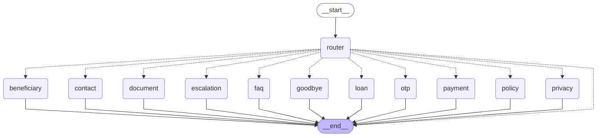

# LangGraph IVR flow

Generated from `build_graph()` by `python -m utils.graph_diagram`. Do not edit by hand.

Dotted edges are the conditional routing in `_route_after_router`. Authentication is not a graph node: each service node calls `ensure_authenticated` (`core/graph/auth_guard.py`) and auth runs inside that turn.
